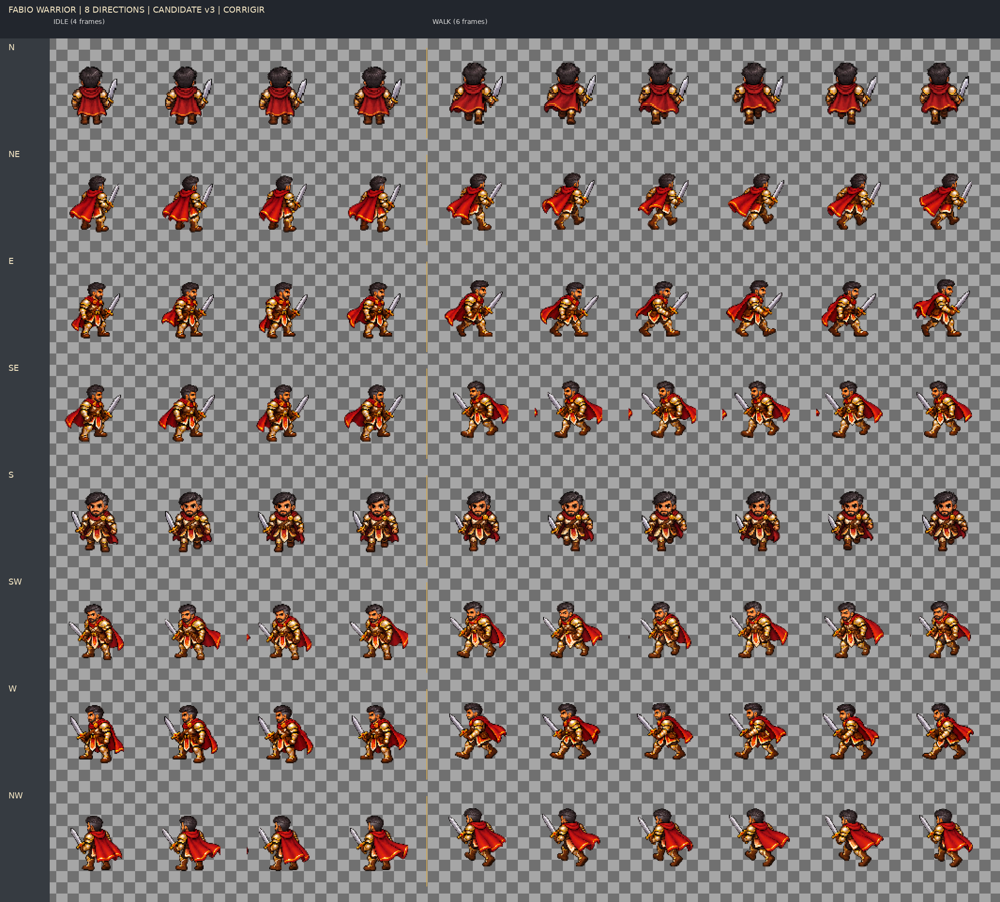

# Fábio Warrior — expansão candidata para oito direções

**Estado geral: CORRIGIR.** Esta entrega amplia o candidato Warrior de Fábio para `N, NE, E, SE, S, SW, W, NW`. Não aprova a arte para produção, não fecha o gate de Godot/Android e não substitui os candidatos v1/v2.

## Arquivos

- `assets/characters/fabio/warrior/fabio_warrior_idle_candidate_v3_8dir.png` — 4 quadros × 8 direções, 384 × 768, RGBA.
- `assets/characters/fabio/warrior/fabio_warrior_idle_candidate_v3_8dir.json` — regiões-fonte, hashes, alpha e diagnóstico por direção/quadro.
- `assets/characters/fabio/warrior/fabio_warrior_walk_candidate_v3_8dir.png` — 6 quadros × 8 direções, 576 × 768, RGBA.
- `assets/characters/fabio/warrior/fabio_warrior_walk_candidate_v3_8dir.json` — regiões-fonte, hashes, alpha e diagnóstico por direção/quadro.
- `tools/art/pack_fabio_8dir.py` — empacotamento reproduzível sem máscara, binarização ou recorte por conteúdo.
- `docs/art/evidence/fabio/fabio_warrior_8dir_candidate_v3_contact.png` — contato em nearest 2× sobre checkerboard.
- As fontes geradas e tentativas de correção ficam em `assets/references/generated-candidates/`; as antigas v1/v2 permanecem intactas.

## Referências e contrato

Usei o concept aprovado de Fábio e os candidatos Warrior anteriores apenas como referência de identidade e escala. O concept não foi cortado em quadros; nenhuma foto privada foi usada. Mantive pele morena, cabelo escuro curto com grisalho nas têmporas, barba aparada, armadura creme/dourada, capa vermelha e espada.

`96×96`, pivô `(48,80)`, idle 4 quadros a 6 FPS e walk 6 quadros a 10 FPS continuam **parâmetros candidatos**. N/S vieram sem alteração de `candidate_v2`. Novas direções foram amostradas das regiões fixas de folhas 6×4 com células de 256×256: redução uniforme nearest para 72×72 e posição fixa `(10,10)` na célula de saída. Não houve espelhamento, trim, remoção de fundo por algoritmo nem alteração automática de alpha.

O conjunto de prompts e as referências da geração estão registrados em [`fabio_warrior_8dir_prompt_log.md`](fabio_warrior_8dir_prompt_log.md). Foi usado o ImageGen nativo do Work Mode.

## Diagnóstico por direção e animação

| Direção | `idle` | `walk` | Evidência/defeito concreto |
|---|---|---|---|
| N | CORRIGIR | CORRIGIR | Copiada da v2; alpha suavizado existente. A escala norte foi ajustada naquela versão, mas pés, pivô e loop ainda não foram validados. |
| NE | CORRIGIR | CORRIGIR | Cardinal diagonal visualmente distinguível. Sem pixel forte na borda vertical da célula-fonte. Alpha e alternância das pernas permanecem pendentes. |
| E | CORRIGIR | CORRIGIR | Perfil voltado à direita. A fonte não tem pixel `alpha ≥128` na borda vertical; permanece halo/alpha suave e a passada não comprova todas as seis fases. |
| SE | CORRIGIR | CORRIGIR | `idle` sem contagem forte na borda. No `walk`, a fonte tem 157 pixels na borda esquerda e 163 na direita (`alpha ≥128`, total das seis células); o contato mostra pequenos resíduos entre quadros. |
| S | CORRIGIR | CORRIGIR | Copiada da v2; alpha suavizado existente. Direção visual sul está presente, mas apoio dos pés e loop continuam sem validação. |
| SW | CORRIGIR | CORRIGIR | A fonte tem 32/75 pixels nas bordas esquerda/direita no `idle` e 27/36 no `walk` (`alpha ≥128`, total por linha); há fragmentos entre quadros. |
| W | CORRIGIR | CORRIGIR | Perfil voltado à esquerda, redesenhado, sem espelhar E. A fonte não tem pixel `alpha ≥128` na borda vertical; alpha e passada ainda precisam de revisão. |
| NW | CORRIGIR | CORRIGIR | A fonte tem 30/55 pixels nas bordas esquerda/direita no `idle` e 0/9 no `walk` (`alpha ≥128`, total por linha); resíduos aparecem no contato. |

Os quadros não são cópias exatas: há 4/4 e 6/6 hashes distintos por linha. Isso só confirma que as imagens diferem. No contato estático, várias passadas — especialmente as diagonais — não mostram claramente, na ordem exigida, contato esquerdo → descida → passagem → contato direito → descida → passagem. Pernas de apoio, aterrissagem dos pés, fechamento do loop e transição idle/walk precisam de correção quadro a quadro.

## Tentativas de correção preservadas

- Na folha cardinal, uma edição via ImageGen para reduzir halo/alpha intermediário diminuiu os pixels intermediários de 599.361 para 561.399, mas ainda não produziu nenhum pixel alpha 255. A fonte original e a edição ficaram guardadas; a versão editada foi escolhida para E/W porque mantém a grade e a contagem.
- Nas folhas NE/SE e SW/NW, uma edição para reduzir o tamanho dentro das células não eliminou consistentemente pixels nas bordas. Na folha SW/NW ela ainda deixou apenas quatro figuras na linha que deveria ter seis de caminhada. Essas edições são preservadas, mas excluídas do atlas; as folhas originais, com seis quadros de caminhada, são as usadas.
- Não apliquei threshold, flood fill ou binarização para mascarar os defeitos.

## Validação

- `python tools/art/pack_fabio_8dir.py`: passou; dimensões, ordem, contagem, arquivos PNG e JSON conferidos.
- Validador da skill `validate_atlas.py`: falha estrutural esperada por alpha intermediário: 73.353 pixels no atlas `idle` e 111.278 no `walk`. Ambos têm zero pixels alpha 255. Não apontou quadros vazios nem pixels tocando bordas das células finais.
- Validador do repositório: exit 1; 14 erros totais, sendo 2 novos por alpha intermediário nesses atlas e 12 preexistentes em outros candidatos. Sem novo erro de quadro vazio ou borda final para estes arquivos.
- Não há executável Godot disponível neste workspace. Importação/render no Godot, escala/SQM, zoom 50–125% e teste Android continuam pendentes.

O diagnóstico de bbox usa alpha como proxy e não identifica botas; não prova pivô, anatomia ou contato. A estrutura de 8 direções está empacotada para revisão, mas todas as linhas permanecem **CORRIGIR** até remover os artefatos na fonte, corrigir a passada e validar em Godot e Android.
