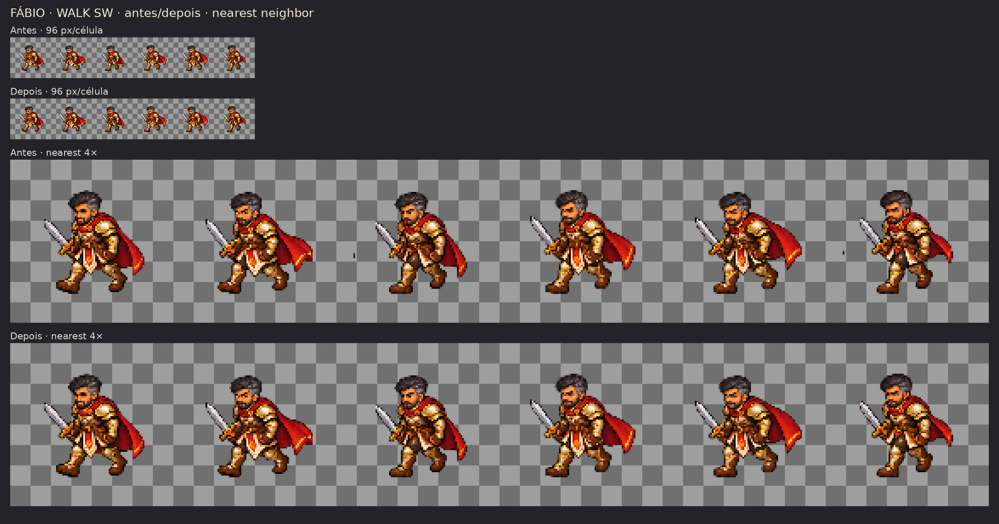
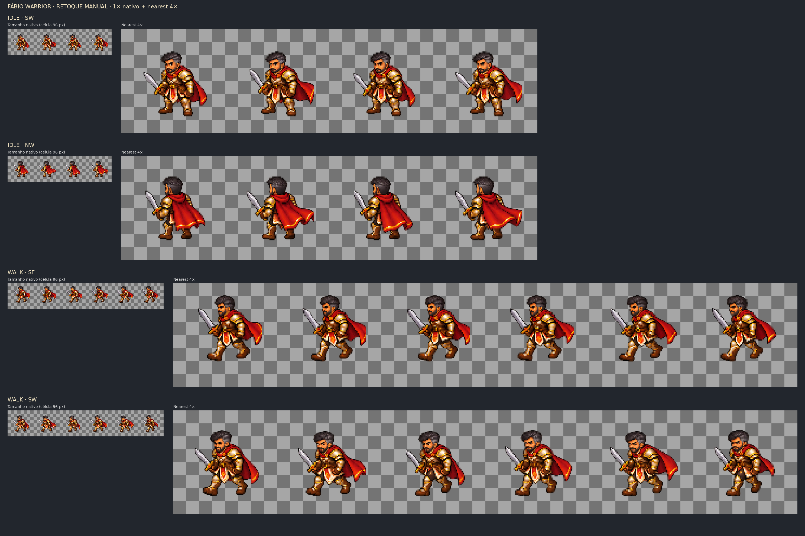

# Fábio Warrior — expansão candidata para oito direções

**Estado geral: CORRIGIR.** Esta entrega amplia o candidato Warrior de Fábio para `N, NE, E, SE, S, SW, W, NW`. Não aprova a arte para produção, não fecha o gate de Godot/Android e não substitui os candidatos v1/v2.

## Arquivos

- `assets/characters/fabio/warrior/fabio_warrior_idle_candidate_v3_8dir.png` — 4 quadros × 8 direções, 384 × 768, RGBA.
- `assets/characters/fabio/warrior/fabio_warrior_idle_candidate_v3_8dir.json` — regiões-fonte, hashes, alpha e diagnóstico por direção/quadro.
- `assets/characters/fabio/warrior/fabio_warrior_walk_candidate_v3_8dir.png` — 6 quadros × 8 direções, 576 × 768, RGBA.
- `assets/characters/fabio/warrior/fabio_warrior_walk_candidate_v3_8dir.json` — regiões-fonte, hashes, alpha e diagnóstico por direção/quadro.
- `tools/art/pack_fabio_8dir.py` — empacotamento reproduzível; retângulos de retoque manual explícitos, sem threshold/flood-fill de alpha.
- `docs/art/evidence/fabio/fabio_warrior_8dir_candidate_v3_contact.png` — contato em nearest 2× sobre checkerboard.
- `docs/art/evidence/fabio/fabio_warrior_8dir_retouch_detail.png` — quatro tiras retocadas em tamanho nativo e nearest 4× sobre checkerboard.
- `docs/art/evidence/fabio/fabio_warrior_walk_sw_before_after.png` — comparação do atlas SW walk antes/depois em tamanho nativo e nearest 4×.
- As fontes geradas e tentativas de correção ficam em `assets/references/generated-candidates/`; as antigas v1/v2 permanecem intactas.

## Referências e contrato

Usei o concept aprovado de Fábio e os candidatos Warrior anteriores apenas como referência de identidade e escala. O concept não foi cortado em quadros; nenhuma foto privada foi usada. Mantive pele morena, cabelo escuro curto com grisalho nas têmporas, barba aparada, armadura creme/dourada, capa vermelha e espada.

`96×96`, pivô `(48,80)`, idle 4 quadros a 6 FPS e walk 6 quadros a 10 FPS continuam **parâmetros candidatos**. N/S vieram sem alteração de `candidate_v2`. Novas direções foram amostradas das regiões fixas de folhas 6×4 com células de 256×256: redução uniforme nearest para 72×72 e posição fixa `(10,10)` na célula de saída. Não houve espelhamento, trim, remoção de fundo por algoritmo ou alteração automática de alpha. As fontes geradas ficaram intactas; o retoque limitado na saída está descrito abaixo.

O conjunto de prompts e as referências da geração estão registrados em [`fabio_warrior_8dir_prompt_log.md`](fabio_warrior_8dir_prompt_log.md). Foi usado o ImageGen nativo do Work Mode.

## Diagnóstico por direção e animação

| Direção | `idle` | `walk` | Evidência/defeito concreto |
|---|---|---|---|
| N | CORRIGIR | CORRIGIR | Copiada da v2; alpha suavizado existente. A escala norte foi ajustada naquela versão, mas pés, pivô e loop ainda não foram validados. |
| NE | CORRIGIR | CORRIGIR | Cardinal diagonal visualmente distinguível. Sem pixel forte na borda vertical da célula-fonte. Alpha e alternância das pernas permanecem pendentes. |
| E | CORRIGIR | CORRIGIR | Perfil voltado à direita. A fonte não tem pixel `alpha ≥128` na borda vertical; permanece halo/alpha suave e a passada não comprova todas as seis fases. |
| SE | CORRIGIR | CORRIGIR | `idle` sem contagem forte na borda. No `walk`, a fonte tem 157 pixels na borda esquerda e 163 na direita (`alpha ≥128`, total das seis células); quatro manchas vermelhas desconectadas foram apagadas do atlas nos quadros 1–4 (índices 0-based 1–4), mas contaminação/alpha suave da fonte e a passada continuam pendentes. |
| S | CORRIGIR | CORRIGIR | Copiada da v2; alpha suavizado existente. Direção visual sul está presente, mas apoio dos pés e loop continuam sem validação. |
| SW | CORRIGIR | CORRIGIR | A fonte tem 32/75 pixels nas bordas esquerda/direita no `idle` e 27/36 no `walk` (`alpha ≥128`, total por linha). Os fragmentos vermelhos desconectados de `idle` e `walk` foram removidos nos quadros documentados abaixo; contaminação de fonte, alpha suave e movimento permanecem pendentes. |
| W | CORRIGIR | CORRIGIR | Perfil voltado à esquerda, redesenhado, sem espelhar E. A fonte não tem pixel `alpha ≥128` na borda vertical; alpha e passada ainda precisam de revisão. |
| NW | CORRIGIR | CORRIGIR | A fonte tem 30/55 pixels nas bordas esquerda/direita no `idle` e 0/9 no `walk` (`alpha ≥128`, total por linha). A mancha vermelha desconectada em `idle` foi removida; escala, alpha e continuidade ainda precisam de validação. |

Os quadros não são cópias exatas: há 4/4 e 6/6 hashes distintos por linha. Isso só confirma que as imagens diferem. No contato estático, várias passadas — especialmente as diagonais — não mostram claramente, na ordem exigida, contato esquerdo → descida → passagem → contato direito → descida → passagem. Pernas de apoio, aterrissagem dos pés, fechamento do loop e transição idle/walk precisam de correção quadro a quadro.

## Tentativas de correção preservadas

- Na folha cardinal, uma edição via ImageGen para reduzir halo/alpha intermediário diminuiu os pixels intermediários de 599.361 para 561.399, mas ainda não produziu nenhum pixel alpha 255. A fonte original e a edição ficaram guardadas; a versão editada foi escolhida para E/W porque mantém a grade e a contagem.
- Nas folhas NE/SE e SW/NW, uma edição para reduzir o tamanho dentro das células não eliminou consistentemente pixels nas bordas. Na folha SW/NW ela ainda deixou apenas quatro figuras na linha que deveria ter seis de caminhada. Essas edições são preservadas, mas excluídas do atlas; as folhas originais, com seis quadros de caminhada, são as usadas.
- O ambiente não tem sessão gráfica (`DISPLAY` vazio) nem Pixelorama, LibreSprite, Piskel ou GIMP instalados; o `apt-cache` local não oferece pacote GIMP. `ImageMagick convert` está instalado e foi usado para inspecionar recortes nativos/nearest. Para manter o retoque revisável e reprodutível, registrei no empacotador oito seleções manuais de borracha para a saída, após a inspeção visual; não substituí personagens nem gerei arte nova.
- Cada seleção limpa RGBA para `(0,0,0,0)` apenas no retângulo indicado. São índices de quadro 0-based e coordenadas locais da célula 96×96, com limite inferior/direito exclusivo:

| Estado/direção | Quadro (índice 0-based) | Retângulo local `[x1,y1,x2,y2)` | Resultado observado |
|---|---:|---|---|
| `idle` SW | 2 | `[10,51,15,63)` | Mancha vermelha desconectada, incluindo bordas de alpha baixo. |
| `idle` NW | 2 | `[10,50,15,61)` | Mancha vermelha desconectada, incluindo bordas de alpha baixo. |
| `walk` SE | 1 | `[10,37,16,54)` | Fragmento vermelho desconectado. |
| `walk` SE | 2 | `[10,37,17,58)` | Fragmento vermelho desconectado e pequenos pixels adjacentes isolados. |
| `walk` SE | 3 | `[10,39,18,55)` | Fragmento vermelho desconectado. |
| `walk` SE | 4 | `[10,36,15,50)` | Fragmento vermelho desconectado. |
| `walk` SW | 2 | `[10,51,14,60)` | No atlas pré-retoque, núcleo isolado em `x=10, y=55–57` (alpha 173/220/208); a caixa também cobre o halo adjacente de alpha 1–6. |
| `walk` SW | 5 | `[10,50,14,59)` | No atlas pré-retoque, núcleo em `x=10, y=53–55` (alpha 76/225/191; `y=54–55` são os dois pixels mais opacos), mais halo adjacente de alpha 1–6. |

Nos oito casos, as caixas foram comparadas com o maior componente alpha conectado de cada quadro antes da edição; nenhuma intersectou esse componente (0 pixels). A comparação SW walk confirma que os fragmentos dos índices 2 e 5 aparecem antes e não aparecem depois; o índice e as coordenadas são locais à célula do atlas final, zero-based. As fontes originais, os atlases v1/v2 e as demais regiões dos atlases foram preservados. Não apliquei threshold, flood-fill, matte removal ou binarização em lote. A comparação de SW walk e a folha de detalhe mostram os quadros em tamanho nativo/nearest 4×:

| Atlas Fábio candidato | Pixels de alpha intermediário | Pixels alpha 255 |
|---|---:|---:|
| idle v1 | 18.262 | 0 |
| walk v1 | 27.648 | 0 |
| idle v2 | 19.610 | 0 |
| walk v2 | 29.794 | 0 |
| idle v3 8-dir | 73.283 | 0 |
| walk v3 8-dir | 110.986 | 0 |

O retoque reduziu os pixels intermediários do v3 em 70 (`idle`) e 292 (`walk`), apenas nos retângulos manuais. Alpha intermediário permanece em todos os seis atlases candidatos; os candidatos v1/v2 não foram alterados.

## Validação

- `python tools/art/pack_fabio_8dir.py`: passou; dimensões, ordem, contagem, arquivos PNG e JSON conferidos.
- `python3 -m py_compile tools/art/pack_fabio_8dir.py`: passou.
- `python tools/art/pack_fabio_8dir.py`: passou; regenerou os dois atlas, JSONs e contato sem alterar as folhas-fonte.
- Validador da skill `validate_atlas.py`: ambos continuam `needs_correction` por alpha intermediário — 73.283 pixels em `idle` e 110.986 em `walk`; zero alpha 255. Não indicou quadros vazios ou pixels tocando as bordas das células finais.
- Validador do repositório: exit 1 com 20 erros, todos por alpha intermediário; 6 são os atlas de Fábio e 14 pertencem a outros candidatos. Sem erro de quadro vazio/borda para Fábio.
- Inspeção visual dos quatro recortes depois do retoque em pixels nativos e nearest 4×: os fragmentos registrados não aparecem mais; pixels residuais de alpha 1–4 em outras áreas não foram apagados em lote.
- `git diff --check`: passou após a revisão deste relatório.
- Não há executável Godot disponível neste workspace. Importação/render no Godot, escala/SQM, zoom 50–125% e teste Android continuam pendentes.

O diagnóstico de bbox usa alpha como proxy e não identifica botas; não prova pivô, anatomia ou contato. O retoque remove os resíduos visíveis registrados, mas não resolve o alpha suave, as outras contaminações da fonte, a passada ou o loop. Todas as linhas permanecem **CORRIGIR** até a revisão artística e a validação no Godot e Android.
