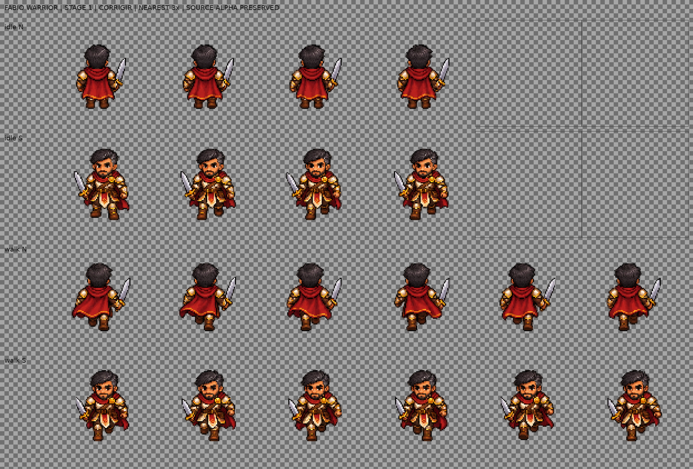
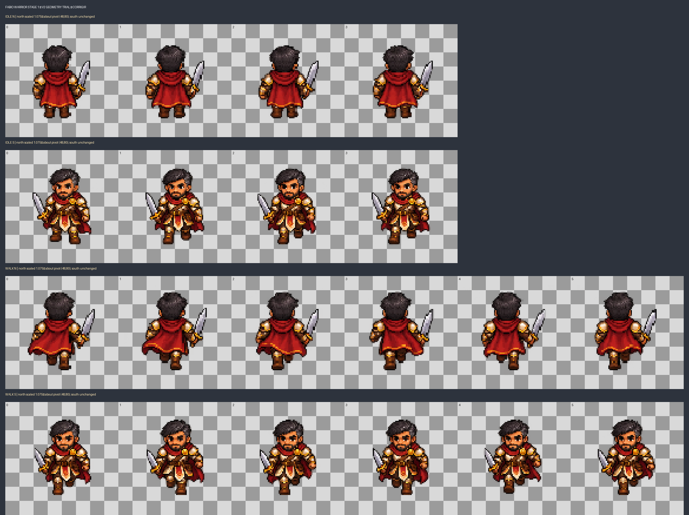

# Fábio Warrior — teste técnico da etapa 1

**Estado: CORRIGIR.** Prancha e atlas são candidatos técnicos, não sprites aprovados. A inclusão de Fábio como quarto personagem jogável do MVP foi aprovada separadamente pelo usuário; este teste não aprova a arte nem libera as etapas seguintes.

## Escopo

- Somente Warrior, norte/sul, `idle` com 4 quadros e `walk` com 6.
- Célula candidata 96 × 96 px; pivô candidato (48,80); animações a 6 e 10 FPS, respectivamente.
- A folha bruta gerada tem 1536 × 1024 px em grade declarada fixa de 6 × 4 células 256 × 256. Linhas 0–3 mapeiam `idle N`, `idle S`, `walk N`, `walk S`; poses vazias no fim das linhas idle não são empacotadas.
- Cada célula foi reduzida uniformemente por nearest para conteúdo 72 × 72, colocado em célula 96 × 96 por uma âncora fixa compartilhada na respectiva direção/animação. Não houve recorte por conteúdo, espelhamento, redesenho ou modificação de alpha.
- O concept aprovado `assets/references/generated-candidates/fabio_vocations_concept.png` permaneceu intacto como referência. Não foi fatiado para inventar movimento. A fonte do teste é o arquivo distinto `assets/references/generated-candidates/fabio_warrior_stage1_source_v1.png`.

## Revisão estática

| Animação | Quadros | Resultado observado | Pendências |
|---|---:|---|---|
| `idle` N/S | 4 por direção | Identidade, capa vermelha, armadura dourada e espada estão presentes. Há pequenas variações entre quadros. | Idle é sutil; a silhueta S fica maior que N em altura e largura. Conferir cardinal, escala relativa e movimento contínuo no Godot. |
| `walk` N/S | 6 por direção | Pernas/capa variam ao longo da tira; a direção norte mostra costas e a sul mostra o rosto. | Revisar a alternância dos apoios, fechamento do loop, posição da espada e sincronização do pivô. Alpha bbox não identifica os pés. |

## Tentativa de correção v2 — geometria N/S

A v2 é uma alternativa separada; v1 e a fonte permanecem intactas. Para reduzir a diferença de escala entre direções, cada quadro norte foi ampliado uniformemente por nearest-neighbor em 1,075× ao redor do pivô candidato (48,80); as linhas sul e as células 96×96 ficaram iguais. Não houve recorte, espelhamento, redesenho, remoção de alpha ou edição manual de pixels.

| Animação | Altura alpha ≥128 N antes → v2 | Altura alpha ≥128 S | Resultado medido |
|---|---:|---:|---|
| `idle` | ~58 → 62 px | ~64 px | Diferença N/S caiu de ~6 para 2 px. |
| `walk` | ~61 → 66 px | 63–64 px | Diferença por pose ficou em 2–3 px; a maior silhueta norte agora pede revisão no loop. |

Os metadados v2 registram 251 valores alpha no idle e 254 no walk; em ambos, alpha máximo 254 e nenhum pixel plenamente opaco. A geometria ficou mais próxima, mas o antialias/alpha suavizado e os clusters graduais continuam fora do padrão final exigido. A inspeção da prancha é estática: não comprova contato dos pés, direção cardinal, continuidade, render Godot ou legibilidade em Android. **v2 permanece `corrigir`, `approved: false`.**

O conteúdo usa muitos detalhes pequenos, sombreados graduais e bordas suavizadas. A leitura é clara na prancha ampliada, porém o acabamento ainda não corresponde com segurança aos contornos duros e à simplicidade de clusters do padrão 2D do projeto. A aparência em tamanho nativo e em zoom de jogo continua pendente.

Após o ajuste de escala, as caixas de alpha ≥ 128 do idle medem aproximadamente 45 × 58 px (N) e 50 × 64 px (S), diferença de cerca de 10% na altura. No walk, N chega a cerca de 53 × 61 px e S a 48 × 64 px. As âncoras são constantes dentro de cada linha; as caixas e seus centros ainda variam entre direções e poses. A última linha ocupada costuma terminar perto de y=79, mas isso não demonstra contato de pé: pode incluir arma, capa ou outros pixels.

## Alpha e inspeção objetiva

Fonte bruta RGBA: 1536 × 1024, SHA-256 `3e167ab828cd9e0ad4063a88e230ef157bff5e86f10b84f013a48fa1ce8160a8`.

- Canal alpha: 255 valores únicos, mínimo 0, máximo 254; 991.461 pixels alpha 0, 581.403 pixels com alpha intermediário (1–254), e zero pixels alpha 255.
- `idle` empacotado: 251 valores únicos, alpha 0–254, com 18.262 pixels intermediários e zero alpha 255.
- `walk` empacotado: 254 valores únicos, alpha 0–254, com 27.648 pixels intermediários e zero alpha 255.
- Checkerboard da folha confirma visualmente transparência real. O canal alpha original foi preservado por amostragem nearest; não foi binarizado ou apagado. O fundo não foi tratado por flood-fill, pois a própria fonte já apresenta transparência com pixels de borda intermediários.

## Arquivos e metadados

- Fonte bruta candidata, concept intacto e documentação: `assets/references/generated-candidates/`.
- Atlases/JSONs v1 e v2: `assets/characters/fabio/warrior/`; ambos permanecem candidatos.
- Contato da tentativa v2: `fabio_warrior_stage1_candidate_v2_contact.png`.
- Empacotador reproduzível: `tools/art/pack_fabio_stage1.py`.
- Prancha xadrez: `docs/art/evidence/fabio/fabio_warrior_stage1_contact.png`.
- Cada JSON marca `status: corrigir`, `approved: false`, `godot_validation: pendente` e `android_validation: pendente`; registra hash da fonte, regiões, âncoras, dimensões, análise alpha e referências.

## Validações e limitações

- `python tools/art/pack_fabio_stage1.py`: passou; produziu atlas RGBA `idle` 384 × 192 e `walk` 576 × 192, ambos com células uniformes 96 × 96.
- JSONs: parse local passou; dimensões, direção, contagem de quadros, referência e hash foram conferidos contra os PNGs v1. Os contratos e dimensões v2 também passam.
- `python tools/art/validate_sprite_atlases.py`: falha esperada por alpha intermediário nos quatro atlas Fábio (v1/v2) e nos seis atlas Melissa V1–V3 já presentes. O validador não reportou célula vazia ou pixels visíveis tocando borda para os candidatos Fábio. Alpha intermediário não foi removido para forçar aprovação.
- `python tools/validate_catalogs.py`: passou após a inclusão aprovada de Fábio como quarto personagem do MVP.
- Godot não está disponível como executável neste workspace. Nenhuma importação/captura de cena, revisão de zoom 50–125%, SQM, loop no motor ou validação Android foi realizada.
- Pixel Engine estava indisponível para geração nesta sessão (4 créditos; mínimo informado de 6); Pixelorama também não está disponível como aplicativo local. A folha técnica foi gerada com o fallback `image_gen` e não é apresentada como arte aprovada.

## Decisão de elenco e próximo gate

GDD/catálogo e protótipo de seleção v0.4 registram Fábio como quarto personagem jogável do MVP, pai de Melissa, após aprovação explícita do usuário. A tentativa v2 reduz a diferença de altura entre direções, sem aprovar as animações. Descrição aprovada para o concept: “Fábio é alto e forte, tem presença serena e olhar atento. Inteligente e reservado, prefere observar, analisar os riscos e planejar a estratégia antes de agir. Melissa parece ter herdado dele a calma e a atenção aos detalhes.”

Revisar e corrigir acabamento/alpha, alinhamento dos pés e ciclo quadro a quadro; comparar a escala da v1 com a alternativa v2. Manter Fábio em **corrigir** até nova revisão estática e validação no Godot; Android também continua pendente. Não ampliar para Archer, Mage, direções adicionais ou efeitos neste incremento.
