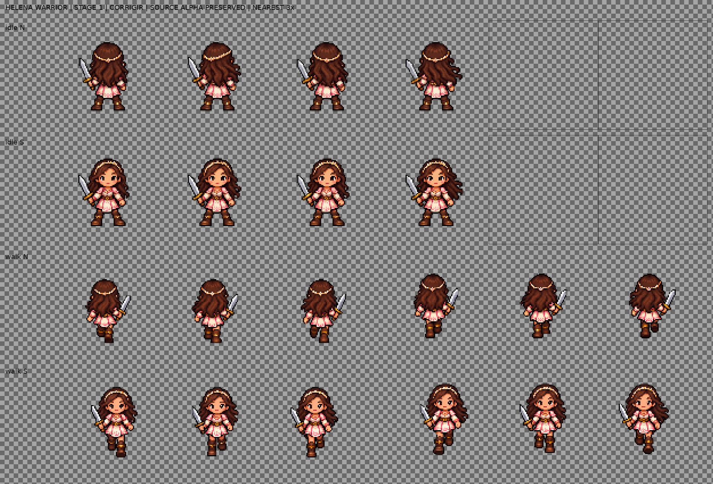

# Helena Warrior — candidata técnica da etapa 1

**Estado: CORRIGIR.** Os atlas e a prancha são candidatos, não arte aprovada para produção. A escolha de Warrior vale somente como suposição operacional para este exemplar: o projeto não declara uma vocação padrão para Helena.

## Escopo e referência

- Uma personagem, uma aparência candidata (Warrior), duas direções opostas (N/S), `idle` com 4 quadros e `walk` com 6.
- O GDD descreve movimento em oito direções, mas não fixa tamanho de célula nem pivô. Para esta etapa 1, o contrato do PR #5 e a direção de arte usam N/S, célula candidata 96×96 px, pivô candidato (48,80), `idle` a 6 FPS e `walk` a 10 FPS. Portanto, o exemplar segue o contrato técnico da etapa, mas 96×96 e (48,80) continuam parâmetros a validar, não escala congelada.
- Concept oficial: `assets/references/concept-rpg-classico.png`. O Git blob SHA foi conferido localmente como `82a60ab282c23d0e6846a10a2d8b5e8614537ac3` (SHA-256 `f42d0080354aa143a113cbab0fbe67bce30dfa7383a80e77d54896a6ab09a99f`). A folha conceitual serviu apenas como referência de identidade; nenhuma parte foi cortada para criar quadros.
- Helena foi representada com cabelo castanho ondulado, tiara clara, olhos castanhos, acentos creme/rosa e espada Warrior, seguindo o GDD e a direção de arte. Nenhuma roupa adicional de equipamento foi introduzida.
- As fontes de animação são geradas separadamente do concept e foram preservadas sem retocar o alpha.

## Arquivos

- Fontes originais RGBA: `assets/references/generated-candidates/helena_warrior_idle_source_v1.png`, `helena_warrior_walk_n_source_v1.png`, `helena_warrior_walk_s_source_v1.png`.
- Atlas e JSON: `assets/characters/helena/warrior/helena_warrior_idle_candidate_v1.{png,json}` e `helena_warrior_walk_candidate_v1.{png,json}`.
- Empacotador e verificador: `tools/art/pack_helena_stage1.py` e `tools/art/validate_helena_stage1.py`.
- Evidência xadrez e diagnóstico: `helena_warrior_stage1_contact.png` e `helena_warrior_stage1_structure.json` neste diretório.

## Grade, alpha e pivô

| Estado | Fonte | Atlas RGBA | Grade final | alpha 0 | alpha intermediário | alpha 255 |
|---|---:|---:|---|---:|---:|---:|
| Idle | 1774×887 | 384×192 | N/S × 4, células 96×96 | 56.149 | 17.568 | 11 |
| Walk | 2 fontes 1536×1024 | 576×192 | N/S × 6, células 96×96 | 90.116 | 20.476 | 0 |

A fonte idle de 1774×887 não divide em oito células quadradas exatas. Foi mantida intacta; para empacotar, uma cópia de trabalho do quadro inteiro foi redimensionada uniformemente por nearest para 1772×886, formando células quadradas de 443×443. Cada célula foi então reduzida uniformemente para conteúdo 72×72 e colocada em uma célula 96×96 com uma única âncora por direção/estado. As duas fontes walk são grades fixas 3×2 com células 512×512; os seis quadros foram lidos em ordem de linha e reduzidos uniformemente para 72×72. Não houve recorte por conteúdo, ajuste quadro a quadro, espelhamento, duplicação ou limpeza de fundo.

O JSON registra pivô (48,80). A caixa de alpha ≥128 fica dentro da célula em todos os quadros. Distância do limite inferior dessa caixa até y=80: idle N −1 px, idle S 0 px; walk N alterna +2 px nos quadros 0–2 e −2 px nos quadros 3–5; walk S varia de +2 a −2 px. A caixa inclui cabelo, arma, roupa e brilho e não certifica contato dos pés. O pivô permanece candidato até revisão no motor.

As fontes mantêm alpha suave. Idle original: 256 valores (0–255), 667.058 pixels intermediários e 667 plenamente opacos. Walk N: 255 valores (0–254), 518.795 intermediários e nenhum pixel alpha 255. Walk S: 255 valores (0–254), 518.217 intermediários e nenhum pixel alpha 255. No atlas walk continuam 20.476 pixels intermediários e nenhum pixel alpha 255. A fonte e o atlas preservam essas bordas; não houve binarização, remoção de matte, flood fill ou retoque. A tentativa de correção generativa do halo não removeu o problema, então não foi usada como substituta.

## Revisão visual e defeitos concretos

- A identidade e as cores creme/rosa, cabelo ondulado, tiara clara e espada permanecem legíveis. As quatro poses de idle mudam pouco; validar se a respiração é suficiente em reprodução.
- As imagens de walk contêm fundo/halo de baixa opacidade e bordas suavizadas, visíveis na fonte. Isso diverge da direção de arte de clusters duros, sem pixels intermediários.
- Walk S tem deriva horizontal: as caixas alpha ≥128 têm centros aproximados x=55,5, 48,5, 39, 57, 47,5 e 40 px nos seis quadros; a diferença chega a 18 px. Como a âncora foi mantida fixa por direção, não houve compensação por quadro.
- Walk N/S tem variação vertical de caixa de cerca de 4 px em relação ao pivô candidato. Pode ser movimento ou erro de alinhamento; a leitura estática não distingue contato real dos pés.
- A composição de idle é pequena dentro das células. Não foi conferida em zoom de jogo, tile/SQM, fundos do motor nem aparelho Android.

## Validação e próximo gate

- `python tools/art/pack_helena_stage1.py`: passou; gerou atlas `idle` 384×192 e `walk` 576×192, RGBA.
- `python tools/art/validate_helena_stage1.py`: passou nas dimensões, grids, contagem de quadros, regiões, direções, metadados 96×96/(48,80), referência por Git blob SHA e limites das caixas alpha ≥128. Emite aviso para alpha intermediário preservado.
- `python -m py_compile tools/art/pack_helena_stage1.py tools/art/validate_helena_stage1.py`: passou.
- Os scripts verificam estrutura e conteúdo mensurável; não validam qualidade de animação ou importação do jogo. Godot, zoom 50–125%, comparação com SQM e Android não foram executados.

Antes de aprovar: remover/refazer o halo com correção manual ou nova geração que preserve transparência nítida; corrigir a deriva de walk S; revisar alternância e contato dos pés quadro a quadro e validar a escala/pivô em Godot. Manter somente esta candidata N/S até revisão. Não gerar Archer, Mage, outras direções ou efeitos neste incremento.
