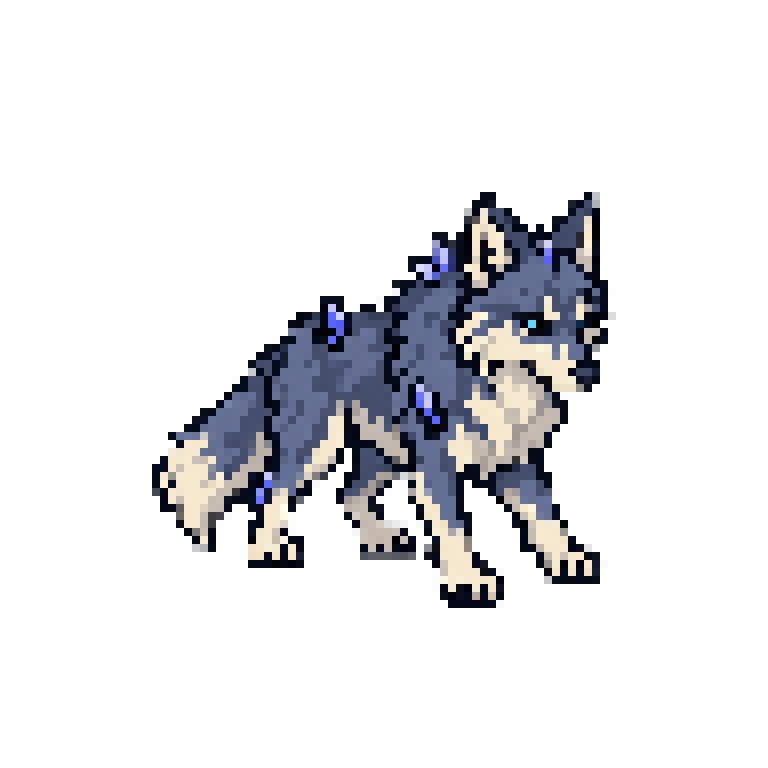

# Lobo — revisão da pose candidata v1

**Data:** 2026-10-15
**Estado artístico:** **CORRIGIR**
**Aprovação:** `approved: false`
**Escopo:** uma pose estática SE em uma célula 96×96. Não houve expansão de lote.

## Referências examinadas

- `assets/references/concept-rpg-classico.png` — consultada como direção visual; não foi recortada.
- Atlas candidatos atuais dos jogadores:
  - `assets/characters/melissa/warrior/melissa_warrior_idle_candidate_v3.png`
  - `assets/characters/helena/warrior/helena_warrior_idle_candidate_v2.png`
  - `assets/characters/maira/warrior/maira_warrior_idle_candidate_v2.png`
  - `assets/characters/fabio/warrior/fabio_warrior_idle_candidate_v3_8dir.png`
- Contrato do catálogo: `wolf`, HP 90, ataque 12, agressivo a curto alcance.

A busca por skill de sprites dentro do repositório, inclusive caminhos ocultos, encontrou a documentação e ferramentas de sprites, mas nenhum outro `SKILL.md` local. Apliquei o skill externo `produce-pixel-sprites` e o skill `imagegen`.

## Arquivos do candidato

- Fonte imagegen final: `assets/references/generated-candidates/wolf/wolf_se_source_v3.png` (1254×1254 RGBA).
- Atlas: `assets/creatures/wolf/wolf_se_candidate_v1.png` (96×96 RGBA).
- Metadados: `assets/creatures/wolf/wolf_se_candidate_v1.json`.
- Empacotador reproduzível: `tools/art/pack_wolf_candidate_v1.py`.
- Preview de revisão, ampliado 8× com nearest: `docs/art/evidence/wolf/wolf_se_nearest_preview_v1.png`.
- Fontes anteriores: `assets/references/generated-candidates/wolf/wolf_se_source_v1.png` e `wolf_se_source_v2.png`.

## Empacotamento e resultado estrutural

O packer redimensiona o canvas-fonte inteiro de 1254×1254 para 72×72 usando **nearest-neighbor**, sem crop, e copia para a célula em [10, 10]. O sprite visível ocupa bbox [19, 24, 77, 81], com a última linha visível em y=80 em relação ao pivô declarado [48, 80]. A prévia 768×768 é apenas para revisão e não é atlas de runtime.

- Dimensões, modo RGBA, transparência e bbox foram conferidos em cada PNG.

| Arquivo | Dimensões | Valores alpha | Intermediários |
|---|---:|---:|---:|
| Fonte v1 | 1254×1254 | 256 | 254 |
| Fonte v2 | 1254×1254 | 256 | 254 |
| Fonte v3 | 1254×1254 | 256 | 254 |
| Atlas nearest | 96×96 | 52 | 50 |
| Preview nearest 8× | 768×768 | 52 | 50 |

- A célula tem transparência, pixels visíveis e nenhum pixel encosta nas bordas.
- O alpha foi preservado pelos samples nearest e **não foi binarizado**.
- O JSON registra o status `corrigir`, `approved: false`, a pose/direção existente e os contratos ainda pendentes.

## Revisão visual e pendências

A silhueta é reconhecível como lobo de quatro patas, com orelhas pontudas, focinho claro, pelo cinza-azulado e orientação SE. A fonte mantém detalhes de pelo mais finos que o padrão compacto do projeto e há mais cristais violeta aparentes que o pedido discreto. Duas edições dirigidas por imagegen não removeram o alpha intermediário; a imagem permanece em **CORRIGIR**. Não usei um filtro posterior para esconder esse defeito.

A entrega contém só 1 pose estática SE, registrada como 1 quadro candidato de idle. O contrato de produção permanece pendente:

| Contrato | Estado |
|---|---|
| Oito direções (N, NE, E, SE, S, SW, W, NW) | Só existe uma pose SE; faltam N, NE, E, S, SW, W e NW |
| Idle, 4 quadros propostos | 1 quadro estático candidato; ciclo completo pendente |
| Walk, 6 quadros propostos | Pendente |
| Attack, 6 quadros propostos | Pendente |
| Hit, 3 quadros propostos | Pendente |
| Death, 6 quadros propostos | Pendente |

Importação/render em Godot, teste em zoom/SQM, legibilidade em Android e aprovação artística continuam pendentes. O preview nearest não comprova render no motor nem no dispositivo.
