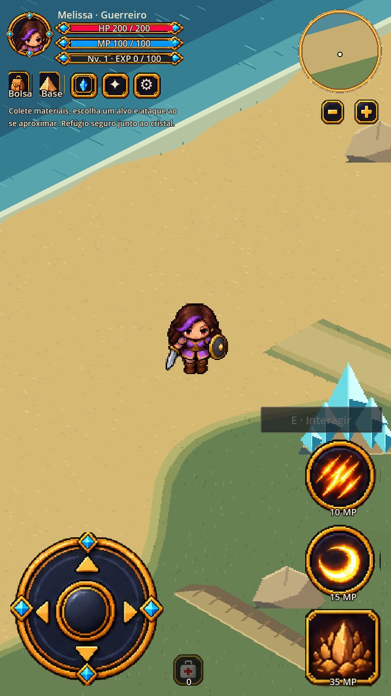
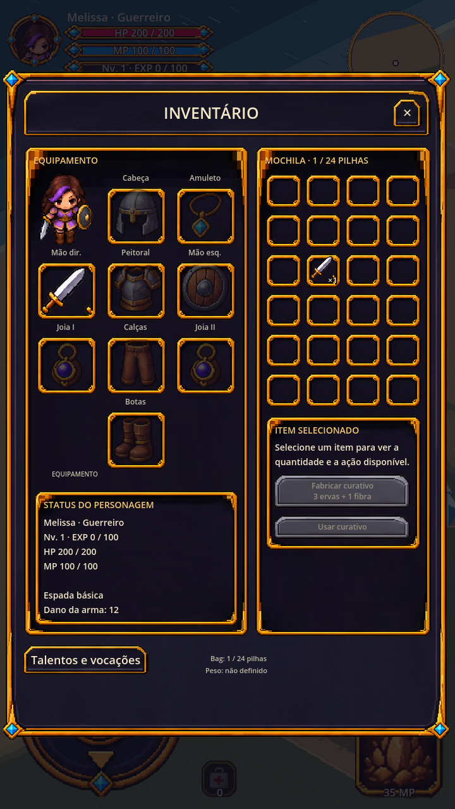
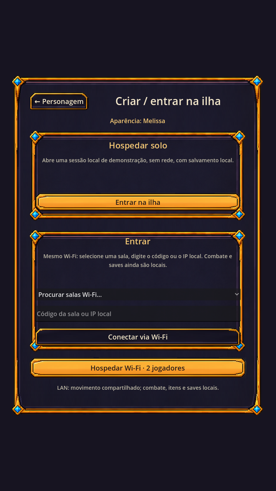
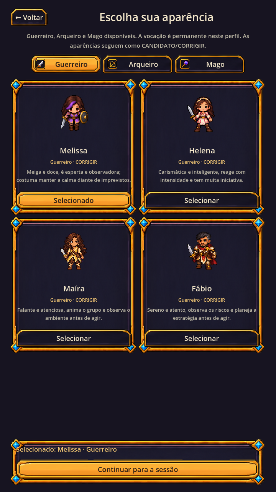

# Reconstrução da HUD e prévia 0.1.9 — 2026-10-18

## Origem e escopo

O workspace da entrega anterior não estava acessível e aquelas mudanças não haviam sido publicadas. Esta reconstrução partiu do commit remoto `2a1784d7c521bcb22e599b008530775dcdeecf99`, preserva a branch `feature/s03-crystal-ui-kit-v2` e foi publicada no commit de código `5f14e623f6787e97e1f6b4aa58778cd132f247f8`. Não é recuperação byte a byte do APK perdido. Engine preservada: Godot 4.5.1.

O usuário aprovou a prototipagem e depois autorizou expressamente reconstruir e salvar no repositório. Foram usadas as referências de inventário/HUD/lobby enviadas na conversa, o kit Crystal v2 e os protótipos versionados existentes. Nenhum conceito foi convertido em animação de produção.

## Comportamento entregue

- Minimap circular com polígono de 96 segmentos: terreno e marcadores usam o frustum ortogonal projetado no chão. Só a área correspondente à câmera e ao zoom atual é mostrada; marcadores fora do círculo são ocultados. Botões −/+ adjacentes usam o mesmo zoom do mundo.
- Três spells verticais de 144×144 unidades lógicas. Nove slots de equipamento de 96×96, ícones proporcionais, personagem, status e scroll. Escala global adapta as unidades à tela; tamanho físico ainda depende do aparelho.
- Bolsa, Base, Atributos e Talentos são painéis exclusivos. Engrenagem abre pausa/configuração. Atributos e pausa não congelam a simulação LAN; no solo a pausa permanece.
- Seleção de Guerreiro/Arqueiro/Mago; 200/100, 150/150 e 100/200 HP/MP. Skills/custos/cooldowns vêm do catálogo. Saves das demais vocações ficam em subpastas próprias, preservando os saves Warrior.
- Warrior com alcances 65/82/135 px, aproximadamente +20% em relação a 54/68/112. Archer usa AGI no dano físico. Mage inclui o cajado no dano mágico. Invisibilidade, ricochete, perfuração, sangramento, queimadura e stun têm verificações locais.
- Feedback VFX desenhado e projetado pela câmera: flechas, projétil/centelha, corte/ondas. A arte de personagem ainda compartilha os sprites Warrior existentes; não há atlas novo de Archer/Mage aprovado. Os botões dessas vocações usam nomes, custos e moldura do kit.
- Mapa fixo de 250×200 = 50.000 tiles, prebaked e versionado em `game/data/first_island_tiles.json`. No startup apenas lê/valida e preenche os batches existentes. 24 lobos, 2 raposas e 4 ursos; spawn/refúgio originais preservados.
- Prévia LAN de movimento para dois jogadores por ENet, descoberta broadcast, código local de seis caracteres e fallback IP. Host limita posição e aplica colisão. Retorna ao lobby após saída do host. **Combate, monstros, coleta, itens e saves ainda são locais**, portanto não é uma expedição co-op completa.

## Validação realizada

Godot importou sem erros de script. Passaram:

- HUD reconstruction em 720×1280, 720×1600 e 480×800; tamanhos, exclusividade, profissão/arma, mana e cooldown.
- Minimap/câmera em três proporções e todos os zooms; projeção, orientação e culling circular.
- Inventário, controles/safe areas, atributos, visão próxima e fluxo Crystal integrado.
- Mapa fixo e população expandida; `bake_first_island.py --check`; catálogo Python.
- Vocations e vocation_combat: HP/MP iniciais, saves isolados, dano, alcance, gasto de MP, bloqueio por recarga, queimadura, invisibilidade e buff.
- Queda/reanimação solo, loop solo, regeneração e smoke completo menu → aparência → sessão → ilha → pausa.
- LAN em dois processos headless: handshake/movimento, rejeição de teleport/NaN, mapa incompatível, desconexão e perda do host. O teste de atributos verifica que a janela não pausa uma conexão ENet.

Comparação gráfica executada em Godot com OpenGL/software sob Xvfb: inventário, HUD circular/hotbar, lobby e seleção. Capturas abaixo. **Não são evidência de toque, safe area real, FPS ou LAN em Android.**

## APK reproduzível

`python3 tools/build/export_android.py --output build/android/ilha-do-cristal-hud-rebuilt.apk --godot /caminho/Godot_v4.5.1-stable_linux.x86_64 --sdk /caminho/android-sdk --parallel-install`

JDK17, Android SDK Platform35/Build Tools35.0.0, template Android4.5.1. Pacote debug `com.fabiofsjunior.ilhadocristal.preview`, versão0.1.9/versionCode10, ARMv7 e ARM64. Assinatura v2/v3, manifesto, ícones, CRC, dados fixos do mapa e permissões INTERNET/ACCESS_NETWORK_STATE/ACCESS_WIFI_STATE passaram. Ferramentas, docs, referências e artefatos anteriores foram excluídos. A chave debug local não é versionada; uma chave diferente pode impedir atualizar uma instalação preview anterior sem desinstalar. Export normal permanece configurável separadamente.

O APK foi exportado com árvore de código limpa no commit acima; metadados e SHA estão em [`artifacts/preview/HUD-0.1.9.json`](../../artifacts/preview/HUD-0.1.9.json). O APK ARM64 anterior em `artifacts/preview/Ilha-do-Cristal-Android-Preview-arm64.apk` é histórico e não contém esta reconstrução. O APK atual foi entregue como anexo persistente junto com ZIP alternativo.

## Próximo incremento

Sincronizar combate autoritativo antes de itens/coleta e save do host: cliente envia intenção, host valida alvo/alcance/custo/cooldown e emite dano/estado/XP uma vez. Depois transações de coleta/drop idempotentes e mundo/inventário salvos somente pelo host. Testar em dois Androids reais: descoberta, código/IP, movimento, pausa/atributos, desconexão, toque, safe area e persistência. Não fechar S0–S4 antes desses aceites.

Terrain Sets64×32/novas elevações2.5D e atlas de monstros mais polido continuam pendentes de arte/amostra validada; a reconstrução preserva a apresentação atual e as poses estáticas existentes.
