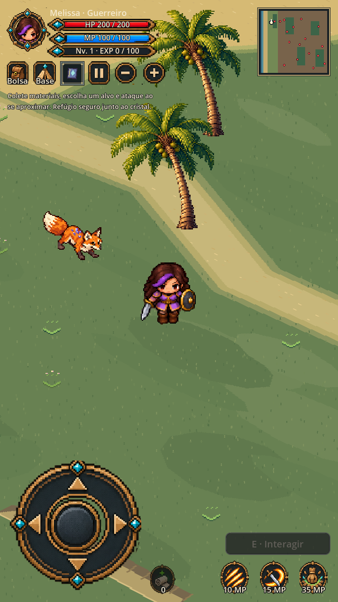
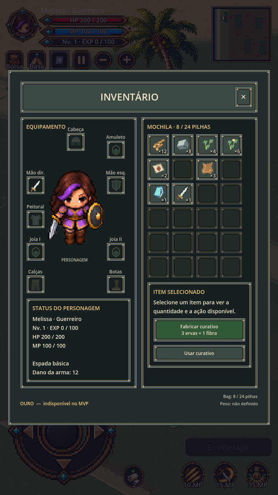
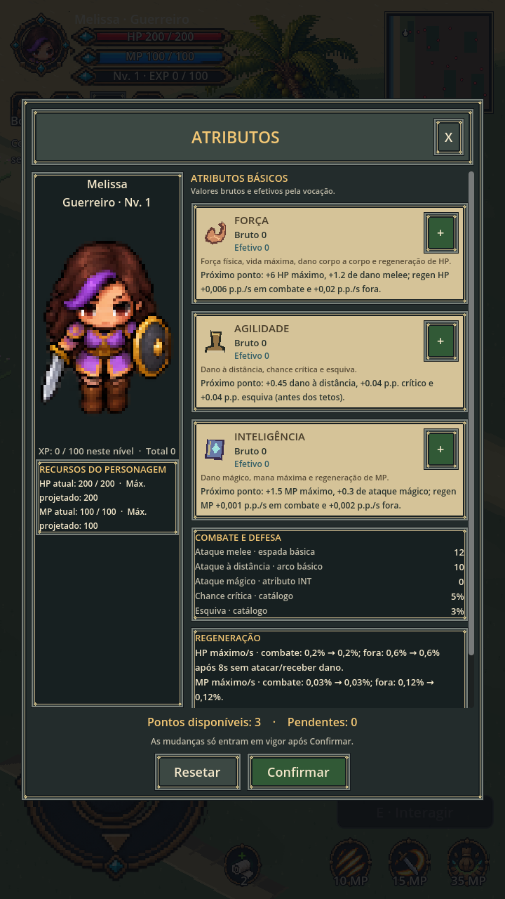

# Correção mobile 0.1.7

Referência: anexos 3/4 fornecidos pelo usuário em 2026-10-17 como composição desejada; anexos 1/2 documentam falhas de texto e oclusão. Adotados equipamento/personagem à esquerda, mochila à direita e atributos em cartões com ícones. Preservados pixel art tropical, identidades, balanceamento, ausência de ouro no MVP e equipamentos ainda não configuráveis. O painel não inventa os itens e números das referências.

Arte original determinística: `tools/art/generate_classic_ui.py`, 6 molduras nine-slice e 25 ícones PNG RGBA nativos. Textos, HP/MP, pontos e quantidades são desenhados pelo Godot. UI é candidata até revisão física; não reaprova sprites de personagens ou criaturas.

## Causas corrigidas

- AnimatedSprite2D usa Y positivo para baixo; Sprite3D usa Y positivo para cima. O offset agora inverte Y, preserva o pivô e deixa os pés em y=0,04, acima dos planos de terreno (até 0,012). Props usam pivô em altura em vez de deslocar Z. O anel segue o mesmo ponto dos pés.
- O clamp da câmera anterior ignorava inclinação/yaw. Agora projeta os quatro cantos do frustum no plano XZ antes de limitar o foco.
- Minimap usava tamanho antigo 2048×1408 e textura de só parte da ilha. Agora gera snapshot das 192×132 células, normaliza em 6144×4224 px e atualiza os inimigos vivos.
- Containers do inventário careciam de expansão horizontal e comprimiam texto/rodapé. Agora há dimensões consistentes, 4 colunas de mochila, equipamento à esquerda e detalhes abaixo da grade.

## Evidência real

Godot 4.5.1, X11/Xvfb TCP, OpenGL Compatibility/Mesa llvmpipe, viewport 720×1280. As imagens são capturas do renderer do jogo, não mockups; inventário e atributos usam estado isolado de teste (8 pilhas e 3 pontos), sem alterar saves pessoais.

Passaram: import Godot, validate_catalogs.py, validate_playable_slice.py, test_mobile_visual_017.gd, test_inventory_overlay_layout.gd (três proporções), test_attributes_window.gd, test_attributes_hud_integration.gd, test_mobile_controls_layout.gd, test_close_view.gd, test_melee_contact_spacing.gd e smoke_playable_slice.gd. O teste novo cobre pivô/profundidade, bordas da câmera, dimensões do minimapa, retirada de marcadores de mortos, ícones, colunas e bounds dos painéis.

## APK e instalação

Preset 0.1.7/versionCode 8. `export_android.py --parallel-install` exporta `com.fabiofsjunior.ilhadocristal.preview`, nome “A Ilha do Cristal — Teste”, e restaura o preset original em finally. A chave da 0.1.6 não está disponível neste ambiente; a variante separada evita remover o app antigo ou seus saves. Progresso não é compartilhado. BUILD_INFO.json registra commit, árvore, dirty state, pacote e SHA-256.

Exportação exige import, assinatura v2/v3, manifesto portrait, ABIs ARMv7/ARM64, ícones, ausência de permissões e exclusão de docs/tools/build. Os logs e o sidecar são locais em build/. O playtest físico de notch, multitouch, estabilidade e desempenho permanece pendente; capturas Mesa não o substituem. Web não foi reexportada.
